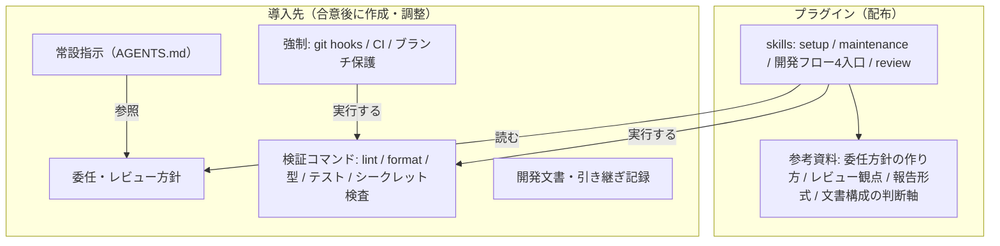
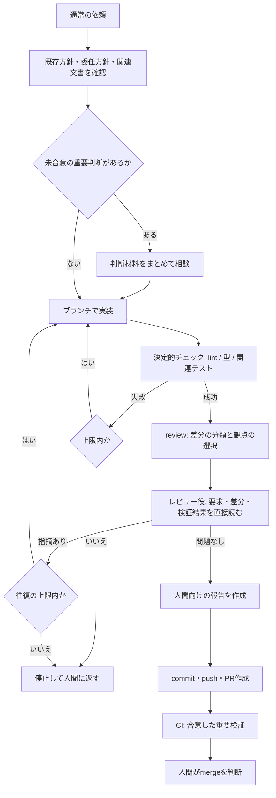
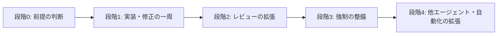

# 3つのレビューの統合と設計案

作成日: 2026-11-05

状態: 設計の提案。要求・仕様として合意したものではない。採用した内容は[開発依頼書](../../../PROJECT_BRIEF.md)または[開発フロー支援の要件・課題](../../plugins/repo-environment/development-workflow.md)へ移し、[README](README.md)に移転先を記載する。

入力: [構想メモ](memo.md)と3つのレビュー。本文では次の略号で出典を示す。

| 略号 | レビュー |
| --- | --- |
| O | [Antigravity／Claude Opus 5.5](review-antigravity-opus-5.5.md) |
| G | [Antigravity／Gemini 4 Argon](review-antigravity-gemini-4-argon.md) |
| C | [Codex／GPT 6 Astra](review-codex-gpt-6-astra.md) |

## 1. レビューの比較

### 1.1 共通する指摘

3つのレビューがほぼ同じ結論に達した論点である。設計の前提として扱う。

| 論点 | 共通する結論 | 出典 |
| --- | --- | --- |
| 強制力の所在 | skillsのdescriptionによる選択は確率的で、必須チェックの保証にならない。強制はgit hooks・CI・ブランチ保護・権限設定に置き、エージェントのhooksは補助とする | O, G, C |
| AIレビューの実行時点 | git hooks内でAIレビューを同期実行しない。git hooksは数秒で終わる決定的なチェックに限る | O, G |
| 観点の選択 | 毎回すべてのレビュー役を起動せず、差分の内容から必要な観点だけを選ぶ | O, G, C |
| レビューの入力 | 実装者の要約ではなく、元の要求、実際の差分、検証結果を直接読ませる | O, G, C |
| 人間に返す条件 | 「要所」をAIのその場の判断だけに任せず、導入先ごとに明文化する | O, G, C |
| 検証の弱体化 | テストの削除・弱体化、ignoreの追加、検証設定の変更を、それ自体レビュー対象にする | G, C（Oはhooks・CIの変更として言及） |
| 結果の陳腐化 | レビューした時点（コミット）を記録し、変更後に古い結果を確認済みとして扱わない | O, G, C |
| 中断と再開 | 会話履歴に頼らず、記録・PR・Issueから現在地を復元できるようにする | O, G, C |
| 人間向けの報告 | 判断が必要な事項と、確認済みの事実・未確認事項を分けて示す | O, G, C |
| 導入順序 | MCPは現時点で不要。まずCodexで一周させ、実際の差分を見てから共通化する | O, C（Gは中身と配置ラッパーの分離を提案） |

### 1.2 一つのレビューだけが示した観点

| 観点 | 内容 | 出典 |
| --- | --- | --- |
| 迷走時の停止条件 | 同じ失敗の修正をN回続けたら止まる。想定外の境界を越える、差分が肥大化する場合も止まる | G |
| 操作ごとの委任範囲 | 実装、試作、依存追加、push、merge、配備、権限拡大を別々に扱う | C |
| 文書量の判断軸 | 規模だけでなく、誤りの影響と戻しやすさ、外部契約の数、関わる人数、判断を後から理解する必要性で決める | C |
| 逆ピラミッド構造 | 人間向け要約を別ファイルにせず、1つの文書の冒頭に結論・図・判断理由を置く | G |
| 設計の具体化 | IF、データ、型をスキーマやコードで正本にし、人間のレビュー対象にする | O |
| ハーネス自体のセキュリティ | hooksの信頼、プロンプトインジェクション、サードパーティ拡張のサプライチェーン | O |
| プラグインの評価 | プラグインなしとの比較、複数回の試行、重要判断の見落としも評価する | C（Oも評価基盤に言及） |

### 1.3 レビュー間の相違と、この案での扱い

| 論点 | 相違 | この案での扱い |
| --- | --- | --- |
| 構成の選び方 | Gは規模別の4プロファイルを提案。Cは規模だけでは不十分とする | 判断軸（C）で決め、プロファイル（G）は代表例として参考資料に置く |
| 文書の形式 | Oはfrontmatterの共通語彙と索引の自動生成、Gは逆ピラミッド、Cはfrontmatterを必要時だけ使う | 逆ピラミッドを基本とし、frontmatterと索引生成は文書が増えて機械処理が必要になった段階で導入する |
| レビュー役の実装 | Oは1つのレビュー入口と観点別資料。Gは観点資料を汎用サブエージェントに読ませる | 両者は両立する。観点はskill内の参考資料に置き、エージェント固有のカスタムエージェント定義に依存しない |
| プラグインの分割 | Oは別プラグイン化を候補に挙げる。Cは需要を確認してから決める | 当面はRepo Environment内で責務だけを分け、独立した需要が確認できたら分割する |
| 最初に試す流れ | Gはレビューフローのskill化から始める。Cは通常の機能追加と再開の一周を先に確かめる | Cの一周を先に成立させ、その中に最小のレビュー手順を含める。複数観点への拡張は次の段階にする |

## 2. 設計案

### 2.1 前提とする判断（要合意）

以下は設計の前提として推奨する判断である。いずれも未合意であり、最初に決める。

| 判断 | 推奨 | 理由 |
| --- | --- | --- |
| プラグインの役割 | 調査・提案だけでなく、合意した範囲を適用・検証する | 既存の依頼書（§6.5）と一致する。提案だけでは人間が設定作業を取り次ぐ負担が残る（C, O） |
| 範囲 | Repo Environment内に置き、環境整備（setup／maintenance）と日々の開発（開発フローskill・レビュー）の責務を分ける | 合意済みの開発フローskillの延長で実現できる。分割は独立した利用需要を確認してから判断する |
| 対応エージェント | Codexで一周させ、その後に他のエージェントへの接続部分を足す | 依頼書（§3.1、§11）と一致する（C, O） |
| 自律度の既定値 | AIはブランチでの実装とPR作成まで。mergeは人間が行う | 実装の承認をmergeや配備の承認と区別する（C, O） |
| AIレビューの実行場所 | まずエージェントの作業完了時に実行する。CIでの非対話実行は後で検討する | git hooksでの同期実行を避け、認証や待ち時間の問題を後回しにできる（O, G） |

### 2.2 全体の構成

エージェントに依存しない中身、エージェントごとの接続、エージェントに依存しない強制の3層に分ける（O, G）。最初はCodexの接続だけを作る。

### 2.3 プラグイン側の構成

既存の構成に、合意済みの開発フロー4入口と、新しいreview skillを加える。

| 要素 | 役割 | 状態 |
| --- | --- | --- |
| setup／maintenance | 環境全体の初期整備と見直し。委任方針、検証コマンド、強制の仕組み、文書構成を導入先と合意して整える | 既存の試作を拡張 |
| 開発フロー4入口 | 要件整理、設計、実装・修正、本番準備。通常の依頼から選ばれ、必要な準備を確認して作業まで進める | 担当範囲は合意済み、未実装 |
| review | 差分を分類して観点を選び、レビュー役を起動し、人間向けの報告を作る。実装・修正の完了時に呼ばれるほか、明示的にも呼べる | 新規の提案 |
| 参考資料 | 委任方針の作り方、レビュー観点、報告形式、文書構成の判断軸、引き継ぎ記録の形式 | 新規の提案 |

設計上の注意を次に示す。

- 観点ごとにskillを作らない。descriptionの衝突と誤起動を避けるため、観点は参考資料として持つ（O, G）。
- ブレストでの批判役は、要件整理の入口の中の手順とする。独立したskillにはしない。
- 補助スクリプトは当面作らない。差分の分類はskillの手順として、`git diff --name-only` と導入先の方針を照合して行う。同じ処理の繰り返しや誤判定が確認できたら、スクリプト化と実行時依存を相談する。

### 2.4 導入先の委任・レビュー方針

構想メモの「要所」を具体化する中心の成果物である。setupで導入先と合意して作り、開発フローskillとreview skillが読む。3つのレビューの提案を次の4区分にまとめる。

| 区分 | 内容の例 | 判定方法 | 出典 |
| --- | --- | --- | --- |
| 操作 | 合意済み設計の実装は自律実行。新規依存・公開API変更・保存方式の変更は相談。push・merge・配備は個別に条件を決める。検証ルールの弱体化・権限拡大は通常の修正に含めない | 操作の種類 | C |
| 変更の対象 | 認証・認可、マイグレーション、公開API、依存定義、インフラ、CI、hooks・エージェント設定、テスト・lint設定 | 差分のパスと種類（機械的） | O, G |
| 作業の経過 | 同じ失敗の修正がN回続く、想定外の境界を越える、差分が想定規模を超える、レビュー指摘が競合する、修正とレビューの往復が上限に達する、検証基盤が壊れている | AIの作業中の判定 | G, C, O |
| 検証の誠実さ | テストの削除・期待値の緩和、ignoreの追加、過剰なモック、検証の未実行・タイムアウト | 差分と実行結果 | G, C |

変更の対象と検証の誠実さは差分から機械的に判定できるため、AIの判断より優先して扱う。作業の経過はAIが判定し、該当したら作業を止めて人間に返す。

小規模なリポジトリでは、常設指示の数行で済む場合もある。保存先は開発フロー支援の要件・課題で未決定の保存先（`.repo-environment/` 案など）と合わせて決める。最初の試作では既存の文書内のMarkdownの節とし、機械処理が必要になったら構造化する。

### 2.5 実装・修正の流れ

git hooksには、formatter、linter、シークレット検査など数秒で終わるものだけを置く。CIは共有された変更の再検証と統合条件を担う。ローカルのhooksだけを迂回不能の保証として扱わない（依頼書 §9）。

### 2.6 レビューの設計

| 項目 | 設計 |
| --- | --- |
| 観点 | セキュリティ、インタフェース・契約、データ、型、検証の誠実さ。導入先の方針で追加・削除できる |
| 選択 | 委任方針の変更対象の区分に一致した観点だけを起動する。内部ロジックの軽微な修正では、決定的チェックだけで終えてよい |
| 入力 | 元の要求・受け入れ条件、実際の差分、周辺コード、検証の実行結果、担当観点と対象外の範囲 |
| 出力 | 観点、重大度、確信度、根拠（ファイルと行）、成立条件、影響、確認方法、人間の判断が必要かどうか |
| 対象の識別 | レビューしたコミットを記録する。以後に変更があれば、影響する観点を再レビューする |
| 実行方法 | 観点資料を読ませたサブエージェントで実行する。サブエージェントが使えない環境では、別セッションでの実行を代替とする |

役割を分けても独立した保証にはならない（C）。同じモデルの盲点を前提に、レビュー結果は「確認できた範囲」として報告する。

### 2.7 人間向けの報告

依頼書 §8.2のレビュー案内を、次の順に具体化する。判断事項を先頭に置き、事実と分ける（C）。

1. 判断してほしい事項と、その判断に必要な事実。
2. 重点的に読んでほしい箇所と理由。
3. 機械検証・AIレビューで確認できた内容と、対象のコミット。
4. 未実行・未確認・対象外の内容。
5. 関連する要求・設計への参照。

報告はPRの説明を基本の置き場とする。PRを使わない導入先では、合意した記録先に置く。

### 2.8 開発文書の構成

| 項目 | 設計 | 出典 |
| --- | --- | --- |
| 構成の判断軸 | 規模、誤りの影響と戻しやすさ、外部契約の数、関わる人数、判断を後から理解する必要性 | C, O |
| 代表例 | 極小（dotfilesなど）、小規模アプリ、frontend＋backend（モノレポ）、マルチリポジトリ。判断軸で決めた結果の例として示す | G |
| 文書の形 | 冒頭に結論、図、人間が確認すべき判断理由を置き、後半に詳細を書く。人間向け要約を別ファイルで二重管理しない | G |
| 設計の正本 | IF、データ、型は、可能ならスキーマや型定義で正本にし、文書は判断理由と境界の説明に絞る | O |
| 要約 | 正本へのリンクと対象時点を付け、要約だけに決定事項を残さない | O, C |
| 機械処理 | frontmatter（例：`status`、`summary`、`related_paths`）と索引の生成は、文書が増えて陳腐化の検出や逆引きが必要になった段階で導入する | O, G, C |
| ブレストからの正本化 | 要件整理の入口で、決定、却下した案と理由、未決定事項、仮説・検証方法に分けて整理し、批判の手順を経てから人間が承認する | G, O |

### 2.9 引き継ぎと中断

専用の状態管理基盤は作らず、PR、Issue、短い記録で成立するかを試す（C）。引き継ぐ情報は、対象、適用済みの変更、検証結果と対象コミット、未解決事項、次の安全な操作とする。

開発フロー支援の要件・課題にある「整備状況の記録」は環境の状態、ここでの引き継ぎはタスクの状態であり、別のものとして扱う。

## 3. 段階的な進め方

| 段階 | 内容 | 完了の目安 |
| --- | --- | --- |
| 0 | 2.1の判断を合意し、要求文書へ記録する | 開発依頼書または開発フロー支援の要件・課題に反映済み |
| 1 | 小規模な既存リポジトリで、委任方針の最小版、実装・修正の入口、単一のレビュー手順、報告形式、引き継ぎを試す | 通常の機能追加依頼から、相談・実装・検証・報告まで進み、別の会話で同じ相談を繰り返さない |
| 2 | review skillに観点の選択と複数観点を加える。既知の欠陥を仕込んだ例で検出を評価する | 観点の選択が差分に合い、仕込んだ欠陥と検証の弱体化を検出できる |
| 3 | setupでgit hooks、CI、ブランチ保護の導入を合意・適用できるようにする | 導入先の既存CIを再利用し、重複導入しない |
| 4 | Claude Code・Antigravityの接続部分、CIでの非対話レビュー、条件付きの自動merge、文書の索引生成を検討する | 製品、実行面、バージョンごとの実機確認結果を記録している |

依頼書 §12.2は、レビュー用サブエージェントの自動起動を最初の一周の成立後に回している。この進め方はそれと一致する。

### 評価

各段階で、プラグインなしの場合と同じ課題で比較し、自然な依頼文で複数回試す（C）。質問回数の削減だけを目標にせず、重要判断の見落としも評価する。

| 観点 | 確かめること |
| --- | --- |
| 判断の適切さ | 必要な相談を漏らさず、合意済み事項を再質問しない |
| 作業の完遂 | 準備確認だけで終わらず、依頼された作業へ進む |
| 軽微な変更への適応 | 不要な文書・設定・レビュー役を増やさない |
| 検証の誠実さ | 未実行や古い結果を成功扱いせず、検証の弱体化を報告する |
| 費用対効果 | 人間の確認時間、手戻り、待ち時間、実行コスト |

## 4. 未決定事項

- 2.1の前提とする判断すべて。
- 委任・レビュー方針の保存先と形式。開発フロー支援の要件・課題の保存先案と合わせて決める。
- review skillの正式名・descriptionと、開発フロー4入口との呼び出し関係。
- リトライや往復の上限の既定値と、導入先での変更方法。
- 補助スクリプトを導入する条件と、その実行時依存。
- 検証の弱体化を機械的に検出する方法。最初はレビュー観点として扱い、誤検知の傾向を見て決める。
- ハーネス自体のセキュリティ（hooksの信頼確認、サードパーティ拡張の採用基準）を、どの段階で要求に加えるか。
