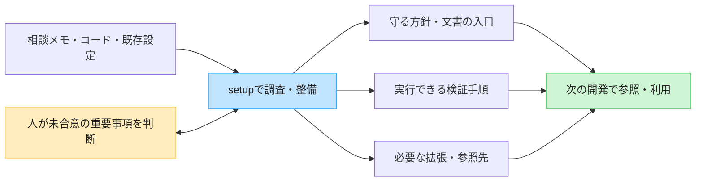
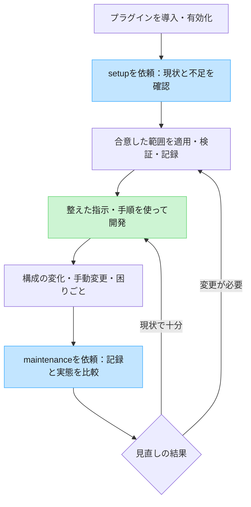
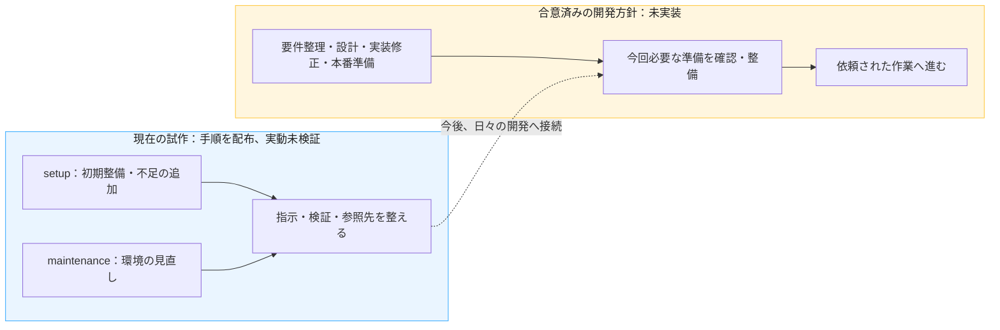

# Repo Environmentを導入すると、何が変わる？

AIと開発するときの「何を守るか」「何で確かめるか」「どこを読むか」を、リポジトリに合わせて整えるプラグインです。毎回の説明や確認の負担を減らし、人が仕様・設計などの判断に集中しやすくすることを目指します。

対象は導入を検討する開発者です。2026-11-07時点の[配布内容](../../../plugins/repo-environment/README.md)と[開発方針](development-workflow.md)に基づいて説明します。**現在は試作版で、デスクトップでの実動検証は未完了です。以下の効果は設計上の期待であり、実測済みの成果ではありません。**

## 1. リポジトリに、次の開発でも使える手掛かりを残す

相談メモ、既存コード、すでにあるテストや文書を入口にできます。専用の書式へ書き直す必要はなく、現在の仕組みを使いながら不足を補います。

図の成果物は、必要なものだけを作成・調整します。小さなリポジトリなら、短い指示と既存の検証だけで十分な場合もあります。

| よくある困りごと | 整えるもの | 期待できる変化 |
| --- | --- | --- |
| 会話が変わるたびに方針を説明する | 合意した方針と正本への入口 | 次の会話でも判断の根拠をたどりやすくなる |
| AIが未合意の技術を選び、手戻りになる | 相談が必要な判断と、委任できる範囲 | 重要な選択に人が関与し、合意済みの通常作業を進めやすくなる |
| 何を実行すれば確認できるか分からない | 実在するlint・テストなどの実行方法 | 機械で確認できることを実行し、結果をレビューに使いやすくなる |
| 拡張を増やしたが、用途や重複が分からない | 必要性・採用理由・導入範囲の記録 | 必要な拡張を選び、不要になったものを整理しやすくなる |
| 別リポジトリの仕様を探し直す | 参照先の役割・読むタイミング・入口 | API契約など、判断に必要な情報へ到達しやすくなる |

これらは[開発依頼書の目的・基本原則](../../../PROJECT_BRIEF.md)を、利用場面に置き換えたものです。設定の数を増やすことは目的にしません。

## 2. 導入から、使い続けるまで

**インストールでskillsを使えるようにし、setupを依頼して対象を整えます。** 導入しただけで設定の適用まで済むわけではありません。skillsはCodexへの作業指示で、実際の編集や検証には、その会話で利用可能なツールを使います。

maintenanceでは、追加に加えて修正・統合・削減も扱います。人が編集した内容と以前の合意を確認し、必要な差分を調整します。図の循環は依頼して行う運用を示しており、常駐監視や定期実行を表してはいません。

未合意の主要技術、新規依存、外部接続などは相談し、合意済みの通常作業は進めます。適用後は変更箇所と検証結果、未確認事項を残します。具体的な規則は[共通の作業規則](../../../plugins/repo-environment/references/workflow.md)を参照してください。

## 3. 例：APIを使うアプリを途中から整える

すでにアプリとテストがあり、API仕様は手元の別リポジトリで管理しているケースを考えます。以下は動作実績ではなく、現在のskillsが指示する進め方の例です。

| 場面 | プラグインを使って行うこと | 次の作業で役立つこと |
| --- | --- | --- |
| 初めて整える | 既存文書・テストを確認し、指示から検証方法へ案内する | 変更後に何を確認するか分かる |
| API仕様を参照する | 「API変更時に、関連リポジトリの仕様ファイルを読む」と記録する | 関係する仕様を探し直す負担を減らせる |
| 拡張の不足が見つかる | 候補の必要性・重複・権限などを調べ、採用を相談する | プロジェクトに合うものだけを選べる |
| テストの実行方法が変わる | maintenanceで実際のコマンドと記録を照合して直す | 古い手順を使い続けることを避けやすくなる |

参照先はローカルに取得済みのものを扱い、共有する役割・入口と個人のローカルパスを分けます。参照設定によってアクセス権が増えるわけではありません。詳細は[関連リポジトリ参照](../../../plugins/repo-environment/references/related-repositories.md)にあります。

## 4. 今あるものと、これから目指すもの

現在の入口は環境整備用の2つのskillsです。今後は、普段の開発依頼から必要な準備の確認と作業までをつなぐ方針が合意されています。

| 状態 | 内容 |
| --- | --- |
| 現在の配布に含む | setup／maintenanceと、合意・検証・拡張選定・関連リポジトリ参照の手順 |
| 合意済み・未実装 | 開発フローの4つの入口、準備確認から作業への接続、自律開発とレビューの方針 |
| 設計中・未採用 | 整備状況の保存形式や専用フォルダなどの具体案 |
| 実動未検証 | デスクトップでの導入・skill実行・適用範囲、導入先での整備と見直しの一連の動作 |

将来の開発フローやレビュー機能は、現在の導入だけでは利用できません。合意と設計案の詳細は[開発フロー支援の要件・課題](development-workflow.md)、確認済みの範囲は[検証記録](../../../tests/repo-environment/validation.md)を参照してください。

## 5. 導入を試すときの見どころ

検証用の別リポジトリで、次のような変化を確認します。

- 次の会話からでも、守る方針・検証方法・仕様の所在をたどれるか。
- 既存の文書や手動変更を生かし、不足だけを補えているか。
- 重要な判断は相談され、合意済みの作業は繰り返し確認せず進むか。
- 実行した検証と未確認事項を区別でき、見直しで不要な設定を減らせるか。

試作には常駐サービスやhooksは含まれず、指示どおりの実行や品質を強制する仕組みはありません。関連リポジトリの自動取得・横断変更も初期版の対象外です。プラグイン本体の更新と、導入先で合意した成果物の変更は別々に扱います。

導入・呼び出し方は[プラグインのREADME](../../../plugins/repo-environment/README.md)、具体的な確認は[受け入れ確認の手順](../../../tests/repo-environment/README.md)を参照してください。
